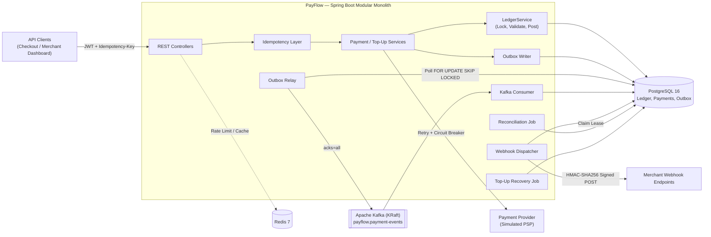
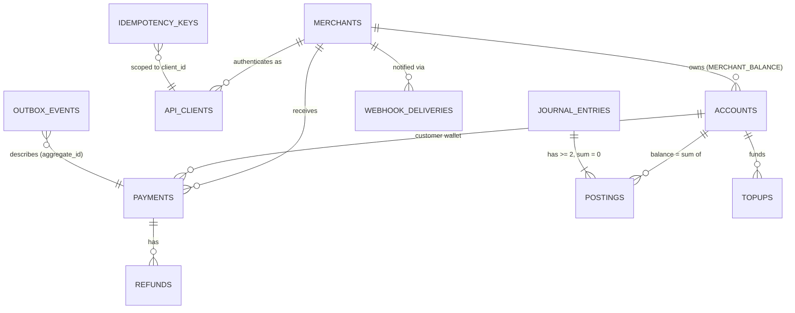

# PayFlow — Distributed Payment Processing Platform

[](https://github.com/24f2006816/payflow/actions/workflows/ci.yml)
[](https://payflow-five-sable.vercel.app)


-231F20?logo=apachekafka&logoColor=white)


> **Live Interactive Console (Vercel):** **[https://payflow-five-sable.vercel.app](https://payflow-five-sable.vercel.app)** — Try the double-entry ledger, idempotent payment lifecycle (`top-up` → `authorize` → `replay` → `partial capture` → `refund` → `reconcile`), and `HMAC-SHA256` webhook inspector directly in your browser.

**PayFlow** is a production-grade financial ledger and payment processing backend engineered with the architectural guarantees used by modern fintech platforms:

- **Immutable Double-Entry Ledger** as the single source of truth, backed by PostgreSQL deferred constraint triggers that reject unbalanced journal entries at `COMMIT`.
- **Two-Layer Idempotent Payments API** supporting multi-step payment lifecycles (`authorize` → `capture` / `cancel` → partial or full `refund`).
- **Resilient Wallet Top-Ups** integrating an external Payment Service Provider (PSP) behind **Resilience4j** retries, circuit breakers, and asynchronous recovery jobs—never holding database transactions open across network calls.
- **Transactional Outbox + Apache Kafka (KRaft)** pipeline with `FOR UPDATE SKIP LOCKED` polling and idempotent consumers.
- **Cryptographically Signed Webhooks** (`HMAC-SHA256`) with lease-based dispatching, capped exponential backoff with full jitter, and SSRF protection.
- **Continuous Financial Reconciliation** using `REPEATABLE READ` snapshots and PostgreSQL advisory locks to prove zero balance drift across all accounts.

---

## Table of Contents

1. [Engineering Guarantees (Why This Is Not a CRUD App)](#engineering-guarantees-why-this-is-not-a-crud-app)
2. [System Architecture](#system-architecture)
3. [Double-Entry Accounting & State Machine](#double-entry-accounting--state-machine)
4. [Quick Start & Running the Project](#quick-start--running-the-project)
5. [Complete Command Reference](#complete-command-reference)
6. [Interactive API Walkthrough (cURL)](#interactive-api-walkthrough-curl)
7. [API Reference & Security](#api-reference--security)
8. [Webhook Signature Verification](#webhook-signature-verification)
9. [Testing & Verification Suite](#testing--verification-suite)
10. [Observability & Operations](#observability--operations)
11. [Cloud Deployment (AWS ECS & Kubernetes)](#cloud-deployment-aws-ecs--kubernetes)
12. [Project Structure & Architecture Decision Records](#project-structure--architecture-decision-records)

---

## Engineering Guarantees (Why This Is Not a CRUD App)

| Failure Mode / Challenge | How PayFlow Solves It | Implementation |
|---|---|---|
| **Money created or lost due to bugs** | Every money movement is an append-only, balanced journal entry ($\sum \text{postings} = 0$). A PostgreSQL `CONSTRAINT TRIGGER ... DEFERRABLE INITIALLY DEFERRED` rejects unbalanced entries at `COMMIT`. | `domain/ledger`, `V1__core_schema.sql` |
| **Concurrent double-spend race conditions** | Participating accounts are locked via `SELECT … FOR UPDATE` in deterministic primary-key order (eliminating deadlocks). Customer wallets enforce a strict no-overdraft invariant (`balance_minor >= 0`) in both domain logic and DB `CHECK` constraints. | `LedgerService`, `AccountRepository`, [ADR-0002](docs/adr/0002-pessimistic-locking-for-balances.md) |
| **Client retries a timed-out POST** | Required `Idempotency-Key` header scoped to `(client_id, key)` with SHA-256 request body fingerprinting. Same key + same payload replays the stored response (`Idempotent-Replayed: true`); same key + mutated payload returns `422`; concurrent in-flight duplicate returns `409`. | `IdempotencyService`, [ADR-0003](docs/adr/0003-two-layer-idempotency.md) |
| **Dual-write split brain (DB vs. Kafka)** | Domain state, ledger postings, and `outbox_events` commit in a single local ACID transaction. A background relay polls with `FOR UPDATE SKIP LOCKED` and publishes to Kafka with `acks=all`. | `OutboxService`, `OutboxRelay`, [ADR-0004](docs/adr/0004-transactional-outbox-polling.md) |
| **Duplicate Kafka event delivery** | At-least-once Kafka consumer deduplicates via a `processed_events` table inside the same transaction that schedules merchant webhook deliveries; poison messages route to a Dead Letter Topic (`.dlt`). | `PaymentEventConsumer`, `KafkaConsumerConfig` |
| **Merchant webhook endpoint downtime** | Workers claim due deliveries with lease timeouts, sign payloads with `HMAC-SHA256`, and retry failures using exponential backoff + jitter before marking `DEAD` after max attempts. | `WebhookDispatcher`, `WebhookSigner`, `RetryBackoff` |
| **Slow or failing upstream PSP** | External PSP HTTP calls execute **outside** database transactions, wrapped in Resilience4j `@Retry` and `@CircuitBreaker`. Timed-out top-ups remain `PENDING` and are reconciled by `TopupRecoveryJob`. | `TopupService`, `ResilientPspClient`, `TopupRecoveryJob` |
| **Silent ledger corruption** | Scheduled and on-demand reconciliation runs inside a `REPEATABLE READ` transaction guarded by `pg_try_advisory_xact_lock`, verifying global zero-sum, cached account balances vs. posting sums, and non-negative customer wallets. | `ReconciliationService` |
| **Cross-tenant data leakage (OWASP API1)** | OAuth2 Resource Server (JWT HS256) embeds `merchant_id` and role claims; accessing another merchant's resources returns `404 Not Found` to prevent ID enumeration. | `SecurityConfig`, `CurrentClient` |
| **Abuse & noisy-neighbor traffic** | Atomic Redis Lua fixed-window rate limiter per client/IP with `X-RateLimit-*` headers and intentional **fail-open** semantics if Redis is unreachable. | `RateLimitInterceptor`, [ADR-0005](docs/adr/0005-redis-fail-open.md) |

---

## System Architecture



> **Why a Modular Monolith?** Every money movement must commit atomically with the payment status change and its outbox event. Splitting the ledger and payment state machine into separate microservices would replace a single ACID database transaction with a distributed saga and eventual consistency without providing horizontal scaling benefits at this layer. Asynchronous workloads (event publishing, webhook delivery, reconciliation) are cleanly isolated and can be extracted into standalone worker deployments without changing domain code. See [ADR-0001](docs/adr/0001-modular-monolith.md).

---

## Double-Entry Accounting & State Machine

### Money Flows (Signed Deltas in Minor Units)

All monetary amounts are represented in integer minor units (e.g., paise for `INR`, cents for `USD` / `EUR`) to eliminate IEEE-754 floating-point rounding errors. Every row below sums to exactly `0`:

| Operation | Customer Wallet | Platform Holds | Merchant Balance | Platform Fees | PSP Clearing | Row Sum |
|---|---:|---:|---:|---:|---:|---:|
| **Top-Up** ($T$) | $+T$ | $0$ | $0$ | $0$ | $-T$ | **$0$** |
| **Authorize** ($A$) | $-A$ | $+A$ | $0$ | $0$ | $0$ | **$0$** |
| **Capture** ($C$, fee $F$) | $+(A - C)$ | $-A$ | $+(C - F)$ | $+F$ | $0$ | **$0$** |
| **Cancel** ($A$) | $+A$ | $-A$ | $0$ | $0$ | $0$ | **$0$** |
| **Refund** ($R$) | $+R$ | $0$ | $-R$ | $0$ | $0$ | **$0$** |

### Payment Lifecycle State Machine

```mermaid
stateDiagram-v2
  [*] --> AUTHORIZED: authorize (funds reserved in PLATFORM_HOLDS)
  [*] --> FAILED: authorize (insufficient customer funds)
  AUTHORIZED --> CAPTURED: capture (full or partial; releases remainder)
  AUTHORIZED --> CANCELED: cancel (releases full reservation)
  CAPTURED --> PARTIALLY_REFUNDED: refund < remaining captured
  CAPTURED --> REFUNDED: refund == remaining captured
  PARTIALLY_REFUNDED --> PARTIALLY_REFUNDED: refund < remaining captured
  PARTIALLY_REFUNDED --> REFUNDED: refund == remaining captured
```



### Entity-Relationship Diagram



---

## Quick Start & Running the Project

### Prerequisites

- **Docker** (v24+) and **Docker Compose** (v2.20+)
- **Java 21** (JDK 21) and **Apache Maven** (3.9+) *(only required if running the app or tests directly on the host)*
- `curl` and `jq` *(required for running `./scripts/demo.sh`)*

---

### Option A: Run the Entire Stack in Docker (Recommended)

This starts **PostgreSQL 16**, **Redis 7**, **Apache Kafka 3.9 (KRaft)**, the **PayFlow API**, an HTTP **Webhook Sink**, **Prometheus**, **Grafana**, and **Kafka UI**.

```bash
# 1. Copy the environment configuration
cp .env.example .env

# 2. Build and start all 8 containers in the background
docker compose up --build -d

# 3. Wait until the application reports healthy
curl -s http://localhost:8080/actuator/health/readiness | jq .

# 4. Run the automated end-to-end payment lifecycle demo
./scripts/demo.sh

# 5. Inspect signed webhooks delivered to the merchant webhook sink
docker compose logs webhook-sink
```

#### Local Service Endpoints

| Service | URL | Credentials / Notes |
|---|---|---|
| **PayFlow API & Swagger UI** | http://localhost:8080/swagger-ui.html | Interactive OpenAPI 3.0 documentation |
| **Health / Readiness Probe** | http://localhost:8080/actuator/health/readiness | Spring Boot Actuator health status |
| **Prometheus Metrics** | http://localhost:8080/actuator/prometheus | Micrometer metrics scrape endpoint |
| **Grafana Dashboards** | http://localhost:3000 | `admin` / `admin` → *PayFlow Overview* dashboard |
| **Prometheus UI** | http://localhost:9090 | Metric query & target status UI |
| **Kafka UI** | http://localhost:8081 | Inspect `payflow.payment-events` & consumer groups |
| **Merchant Webhook Sink** | http://localhost:8082 | Echo server receiving signed webhook `POST`s |

---

### Option B: Run Infrastructure in Docker & App on Host (Local Development)

Ideal for fast iteration and debugging in IntelliJ IDEA or VS Code:

```bash
# 1. Start only PostgreSQL, Redis, Kafka, and the webhook sink
docker compose up -d postgres redis kafka webhook-sink

# 2. Run the Spring Boot app on the host with demo seed data enabled
SPRING_PROFILES_ACTIVE=seed,local mvn spring-boot:run
```

---

## Complete Command Reference

### `Makefile` Shortcuts

```bash
make up        # Build and start the full 8-service Docker Compose stack in the background
make down      # Stop and remove all containers and volumes (docker compose down -v)
make logs      # Tail live logs from the PayFlow app and webhook-sink containers
make demo      # Execute ./scripts/demo.sh against the running local stack
make run       # Run the Spring Boot application on the host with profile `seed,local`
make unit      # Run fast domain unit tests (mvn -B test, no Docker needed)
make test      # Run unit + Testcontainers integration tests (mvn -B verify, requires Docker)
```

### Maven Build & Test Commands

```bash
# Compile main and test sources
mvn -B test-compile

# Run fast domain unit tests (*Test.java — no Docker required)
mvn -B test

# Run full verification: unit tests + Testcontainers integration tests (*IT.java)
mvn -B verify

# Package executable layered JAR (skipping tests)
mvn -B package -DskipTests

# Run a single test class
mvn -B test -Dtest=PostingPlansTest
mvn -B verify -Dit.test=PaymentFlowIT
```

### Offline Verification Suite (No Maven or Docker Required)

If you are in an air-gapped environment with only `javac` (JDK 21) and a local PostgreSQL server:

```bash
PSQL="psql -U postgres" ./tools/offline-verification/run_all.sh
```

This executes 5 standalone verification stages:
1. `1_schema_invariants.sh` — Applies Flyway migrations and tests all 13 database-level constraints & triggers.
2. `2_concurrency.sh` — Fires 30 parallel database workers attempting to spend from a single wallet to prove zero overdraft and deadlock freedom.
3. `3_application_sql.sh` — Prepares and executes all 15 raw SQL queries used in `JdbcTemplate` repositories.
4. `4_domain_unit_tests.sh` — Compiles the domain package with `javac -Xlint:all -Werror` and runs all 36 domain unit tests.
5. `5_syntax_check.sh` — Parses all 85 Java source files to verify syntax integrity.

---

## Interactive API Walkthrough (cURL)

When running with the `seed` profile (enabled by default in Docker Compose and `make run`), the following credentials and accounts are pre-populated:

### Seeded Credentials & Accounts

| Client ID | Client Secret | Role | Associated Entity / Notes |
|---|---|---|---|
| `admin-cli` | `admin-secret-change-me` | `ADMIN` | Platform operator (can onboard merchants & run reconciliation) |
| `checkout-service` | `service-secret-change-me` | `SERVICE` | Internal checkout service (can top up wallets & initiate payments) |
| `acme-merchant` | `merchant-secret-change-me` | `MERCHANT` | Scoped to **Acme Foods** (`11111111-1111-1111-1111-111111111111`) |

- **Acme Foods Merchant ID**: `11111111-1111-1111-1111-111111111111`
- **Acme Foods INR Balance Account**: `22222222-2222-2222-2222-222222222222`
- **Customer Wallet A (INR)**: `33333333-3333-3333-3333-333333333333`
- **Customer Wallet B (INR)**: `44444444-4444-4444-4444-444444444444`

### Step-by-Step cURL Commands

```bash
# 1. Obtain a JWT access token for the checkout service
TOKEN=$(curl -s -X POST http://localhost:8080/v1/auth/token \
  -H "Content-Type: application/json" \
  -d '{"client_id":"checkout-service","client_secret":"service-secret-change-me"}' | jq -r .access_token)

# 2. Top up Customer Wallet A with ₹500.00 (50,000 paise)
curl -s -X POST http://localhost:8080/v1/topups \
  -H "Authorization: Bearer $TOKEN" \
  -H "Content-Type: application/json" \
  -H "Idempotency-Key: topup-001-demo" \
  -d '{
    "accountId": "33333333-3333-3333-3333-333333333333",
    "amountMinor": 50000,
    "currency": "INR"
  }' | jq .

# 3. Authorize a payment of ₹120.00 (12,000 paise) to Acme Foods
PAYMENT=$(curl -s -X POST http://localhost:8080/v1/payments \
  -H "Authorization: Bearer $TOKEN" \
  -H "Content-Type: application/json" \
  -H "Idempotency-Key: pay-auth-001-demo" \
  -d '{
    "merchantId": "11111111-1111-1111-1111-111111111111",
    "customerAccountId": "33333333-3333-3333-3333-333333333333",
    "amountMinor": 12000,
    "currency": "INR",
    "externalRef": "order_9876",
    "description": "Order #9876"
  }')
echo "$PAYMENT" | jq .
PAYMENT_ID=$(echo "$PAYMENT" | jq -r .id)

# 4. Partial Capture of ₹100.00 (10,000 paise -> 2% fee = 200 paise; 2,000 paise released back to customer)
curl -s -X POST "http://localhost:8080/v1/payments/$PAYMENT_ID/capture" \
  -H "Authorization: Bearer $TOKEN" \
  -H "Content-Type: application/json" \
  -H "Idempotency-Key: pay-cap-001-demo" \
  -d '{"amountMinor": 10000}' | jq .

# 5. Partial Refund of ₹25.00 (2,500 paise)
curl -s -X POST "http://localhost:8080/v1/payments/$PAYMENT_ID/refunds" \
  -H "Authorization: Bearer $TOKEN" \
  -H "Content-Type: application/json" \
  -H "Idempotency-Key: pay-ref-001-demo" \
  -d '{"amountMinor": 2500, "reason": "Customer returned item"}' | jq .

# 6. Check Customer Wallet balance and double-entry statement
curl -s "http://localhost:8080/v1/accounts/33333333-3333-3333-3333-333333333333" \
  -H "Authorization: Bearer $TOKEN" | jq .

curl -s "http://localhost:8080/v1/accounts/33333333-3333-3333-3333-333333333333/postings?limit=10" \
  -H "Authorization: Bearer $TOKEN" | jq .

# 7. Trigger an on-demand Ledger Reconciliation run (requires ADMIN token)
ADMIN_TOKEN=$(curl -s -X POST http://localhost:8080/v1/auth/token \
  -H "Content-Type: application/json" \
  -d '{"client_id":"admin-cli","client_secret":"admin-secret-change-me"}' | jq -r .access_token)

curl -s -X POST http://localhost:8080/v1/admin/reconciliation/runs \
  -H "Authorization: Bearer $ADMIN_TOKEN" | jq .
```

A ready-to-import Postman collection is also available at [`postman/payflow.postman_collection.json`](postman/payflow.postman_collection.json).

---

## API Reference & Security

All endpoints are versioned under `/v1`, return RFC 7807 `application/problem+json` error payloads with machine-readable `code` fields, and echo `X-Request-Id` on every response. Every state-mutating `POST` that moves money requires an `Idempotency-Key` header (`8..255` ASCII characters).

| Method | Endpoint | Roles Allowed | Idempotent | Description |
|---|---|---|---|---|
| `POST` | `/v1/auth/token` | Public | No | Exchange `{client_id, client_secret}` for a 15-minute HS256 JWT |
| `POST` | `/v1/accounts/wallets` | `ADMIN`, `SERVICE` | Optional | Open a new `CUSTOMER_WALLET` account (`INR`, `USD`, or `EUR`) |
| `GET` | `/v1/accounts/{id}` | Any (Merchant: own only) | — | Retrieve current account balance and status |
| `GET` | `/v1/accounts/{id}/postings` | Any (Merchant: own only) | — | Keyset-paginated (`?before=&limit=`) immutable ledger statement |
| `POST` | `/v1/merchants` | `ADMIN` | No | Onboard merchant, open `INR`/`USD`/`EUR` balance accounts, issue webhook secret |
| `GET` | `/v1/merchants/{id}` | `ADMIN`, Own Merchant | — | Fetch merchant details and balance account map |
| `PATCH` | `/v1/merchants/{id}/webhook` | `ADMIN`, Own Merchant | No | Update merchant webhook URL (validated against SSRF rules) |
| `POST` | `/v1/topups` | `ADMIN`, `SERVICE` | **Required** | Charge external PSP and credit customer wallet (`201` final, `202` if `PENDING`) |
| `GET` | `/v1/topups/{id}` | `ADMIN`, `SERVICE` | — | Poll top-up status |
| `POST` | `/v1/payments` | `ADMIN`, `SERVICE` | **Required** | Authorize payment & reserve customer funds (`status=FAILED` if insufficient balance) |
| `POST` | `/v1/payments/{id}/capture` | `ADMIN`, `SERVICE`, Own Merchant | **Required** | Capture full or partial (`{amountMinor}`) authorized amount |
| `POST` | `/v1/payments/{id}/cancel` | `ADMIN`, `SERVICE`, Own Merchant | **Required** | Void an `AUTHORIZED` payment and release reserved funds |
| `POST` | `/v1/payments/{id}/refunds` | `ADMIN`, `SERVICE`, Own Merchant | **Required** | Issue full or partial refund (`{amountMinor, reason}`) against captured balance |
| `GET` | `/v1/payments/{id}` | `ADMIN`, `SERVICE`, Own Merchant | — | Get payment details |
| `GET` | `/v1/payments?merchantId=` | `ADMIN`, `SERVICE`, Own Merchant | — | List recent payments for a merchant |
| `POST` | `/v1/admin/reconciliation/runs` | `ADMIN` | No | Execute immediate snapshot ledger reconciliation |
| `GET` | `/v1/admin/reconciliation/runs/latest` | `ADMIN` | — | Fetch latest reconciliation report |

---

## Webhook Signature Verification

PayFlow delivers asynchronous notifications (`payment.authorized`, `payment.failed`, `payment.captured`, `payment.canceled`, `payment.refunded`) via `HTTP POST` to the merchant's configured `webhookUrl`.

### Headers Sent

- `PayFlow-Event-Id`: Unique UUID of the outbox event (use this to deduplicate at-least-once deliveries)
- `PayFlow-Event-Type`: Event type (e.g., `payment.captured`)
- `PayFlow-Signature`: `t=<unix_epoch_seconds>,v1=<hex_hmac_sha256>`

### Verifying the Signature

1. Split `PayFlow-Signature` on `,` to extract the timestamp `t` and signature `v1`.
2. Reject the webhook if $| \text{now} - t | > 300\text{ seconds}$ (prevents replay attacks).
3. Compute `HMAC-SHA256(webhook_secret, t + "." + raw_request_body)` and compare with `v1` using a constant-time byte comparison (`MessageDigest.isEqual`).

---

## Testing & Verification Suite

| Test Suite | Command | Coverage & Proof |
|---|---|---|
| **Domain Unit Tests** (`*Test.java`) | `mvn test` | Exact minor-unit `Money` arithmetic, `JournalDraft` zero-sum validation, `PostingPlans` delta calculations, `PaymentRules` state transitions, `FeeCalculator` basis points, `WebhookSigner` HMAC/replay protection, `RetryBackoff` bounds. |
| **Full Payment Lifecycle IT** (`PaymentFlowIT`) | `mvn verify` | End-to-end top-up (success + PSP decline), authorize, idempotent replay, payload mismatch (`422`), partial capture with fee split, two partial refunds, over-refund rejection, and clean reconciliation. |
| **Concurrency & Race Conditions IT** (`ConcurrencyIT`) | `mvn verify` | **50 concurrent threads** attempting to spend ₹100 from a ₹500 wallet (proves exactly 5 succeed and balance is `0`); **20 concurrent threads** sending the same `Idempotency-Key` (proves single charge); **20 concurrent partial refunds** (proves total refunded never exceeds captured). |
| **Kafka & Webhook Delivery IT** (`WebhookDeliveryIT`) | `mvn verify` | Outbox → Kafka → Consumer → Webhook Dispatcher against an embedded HTTP receiver that fails the first 2 attempts with `500` and succeeds on the 3rd, verifying signature validity and `DELIVERED` state. |
| **Security & Tenant Isolation IT** (`SecurityIT`) | `mvn verify` | Unauthenticated (`401`), invalid secret (`401`), RBAC (`403`), cross-tenant merchant access (`404`), and SSRF blocking of localhost/private IP webhook URLs (`400`). |
| **Rate Limiting IT** (`RateLimitIT`) | `mvn verify` | Verifies `X-RateLimit-Remaining` headers and `429 Too Many Requests` with `Retry-After` once the window limit is exceeded. |

---

## Observability & Operations

- **Custom Prometheus Metrics** (`/actuator/prometheus`):
  - `payflow_payments_total{operation, outcome}` — Counter of payment operations (`authorize`, `capture`, `cancel`, `refund`, `topup`)
  - `payflow_ledger_post_seconds` — Timer measuring journal entry locking + persistence latency
  - `payflow_outbox_backlog` — Gauge tracking unpublished events in `outbox_events`
  - `payflow_webhooks_total{outcome}` — Counter of webhook deliveries (`delivered`, `retry`, `dead`)
  - `payflow_reconciliation_mismatches` — Gauge of ledger discrepancies detected by the latest reconciliation run (`0` = healthy)
  - `payflow_ratelimit_rejected_total` — Counter of `429` rate-limited requests
- **Pre-provisioned Grafana Dashboard**: Automatically loaded at http://localhost:3000 from [`observability/grafana/dashboards/payflow-overview.json`](observability/grafana/dashboards/payflow-overview.json).
- **Structured Logging**: Uses Elastic Common Schema (ECS) JSON logging in the `prod` profile with automatic correlation via `X-Request-Id` and Micrometer OpenTelemetry trace/span IDs.
- **Kubernetes / ECS Health Probes**:
  - Liveness: `/actuator/health/liveness`
  - Readiness: `/actuator/health/readiness` (verifies PostgreSQL, Redis, and Kafka connectivity)

---

## Cloud Deployment (AWS ECS & Kubernetes)

- **Multi-Stage Container Build**: [`Dockerfile`](Dockerfile) builds a layered Spring Boot JAR on `eclipse-temurin:21-jre-alpine`, running as an unprivileged `app` user with container-aware JVM flags (`-XX:MaxRAMPercentage=75 -XX:+ExitOnOutOfMemoryError`).
- **AWS Reference Architecture**: Step-by-step production deployment guide in [`docs/AWS_DEPLOYMENT.md`](docs/AWS_DEPLOYMENT.md) covering **ECS Fargate**, **RDS PostgreSQL 16 (Multi-AZ)**, **ElastiCache Redis**, **Amazon MSK (Kafka)**, **AWS Secrets Manager**, and **GitHub Actions OIDC → Amazon ECR** CI/CD pipelines.
- **Deployment Manifests**:
  - AWS ECS Task Definition: [`deploy/aws/ecs-task-definition.json`](deploy/aws/ecs-task-definition.json)
  - Kubernetes Deployment, Service, HPA & PodDisruptionBudget: [`deploy/k8s/payflow.yaml`](deploy/k8s/payflow.yaml)

---

## Project Structure & Architecture Decision Records

```text
payflow/
├── src/main/java/com/payflow/
│   ├── domain/          # Pure, framework-free domain core (Money, JournalDraft, PostingPlans, PaymentRules, Signer)
│   ├── ledger/          # LedgerService (pessimistic locking & balanced journal posting), JPA entities
│   ├── account/         # Customer wallets, account balance queries, keyset-paginated statements
│   ├── merchant/        # Merchant onboarding, Redis caching, SSRF-safe webhook URL validation
│   ├── payment/         # Authorize, capture, cancel, refund orchestration & REST controller
│   ├── topup/           # Wallet top-ups, simulated PSP, Resilience4j circuit breaker/retry, recovery job
│   ├── idempotency/     # Two-layer Idempotency-Key locking, request fingerprinting, response replay
│   ├── outbox/          # Transactional outbox writer & FOR UPDATE SKIP LOCKED Kafka relay
│   ├── webhook/         # Idempotent Kafka consumer, lease-based webhook dispatcher, Dead Letter Topic config
│   ├── reconciliation/  # REPEATABLE READ ledger invariant checker with Postgres advisory lock
│   ├── security/        # OAuth2 JWT issuer/resource server, tenant isolation, Redis Lua rate limiter
│   └── common/ config/  # RFC 7807 ProblemDetail error handler, X-Request-Id filter, typed @ConfigurationProperties
├── src/main/resources/
│   ├── db/migration/    # Flyway SQL migrations (V1 core schema & triggers, V2 system accounts)
│   └── db/seed/         # Demo merchant, API clients, and customer wallets (loaded in `seed` profile)
├── docs/
│   ├── AWS_DEPLOYMENT.md
│   ├── LEARNING_GUIDE.md
│   └── adr/             # Architecture Decision Records (0001 through 0005)
├── deploy/              # AWS ECS task definition & Kubernetes (EKS) manifests
├── observability/       # Prometheus scrape config & provisioned Grafana dashboard
├── postman/             # Postman collection for interactive API testing
├── scripts/             # End-to-end automated cURL walkthrough (demo.sh)
└── tools/               # Standalone offline SQL & Java verification suite
```

### Architecture Decision Records (ADRs)

- [ADR-0001: Modular Monolith with Internal Async Boundaries](docs/adr/0001-modular-monolith.md)
- [ADR-0002: Pessimistic Locking (`SELECT … FOR UPDATE`) for Account Balances](docs/adr/0002-pessimistic-locking-for-balances.md)
- [ADR-0003: Two-Layer Idempotency (`Idempotency-Key` Table + Domain Natural Keys)](docs/adr/0003-two-layer-idempotency.md)
- [ADR-0004: Transactional Outbox with `FOR UPDATE SKIP LOCKED` Polling Relay](docs/adr/0004-transactional-outbox-polling.md)
- [ADR-0005: Redis Fixed-Window Rate Limiting with Fail-Open Semantics](docs/adr/0005-redis-fail-open.md)
- [Engineering Learning Guide & Interview Prep](docs/LEARNING_GUIDE.md)
- [Verification & Build Status Checklist](STATUS.md)
