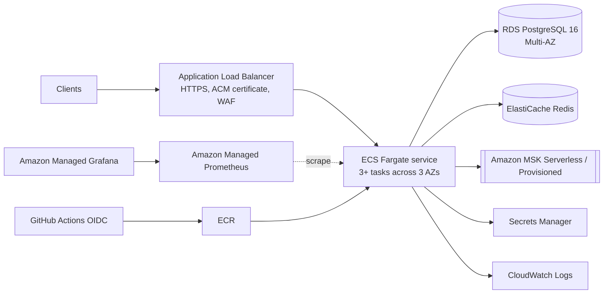

# Deploying PayFlow to AWS

> Not executed: these steps and files were written without access to an AWS account. Validate each step.

## Target architecture

**Why ECS Fargate over EKS?** One stateless service doesn't need a Kubernetes control plane. Fargate gives
rolling deploys, autoscaling and no node management. Choose EKS (manifests in `deploy/k8s/`) when you already
run Kubernetes or have many services.

## Steps
1. **Network:** VPC with 3 public subnets (ALB) and 3 private subnets (tasks, RDS, ElastiCache, MSK). NAT gateway for outbound webhooks.
2. **Data stores**
   - RDS PostgreSQL 16, Multi-AZ, `rds.force_ssl=1`, automated backups + PITR. Create DB `payflow`, user `payflow`.
   - ElastiCache Redis (cluster mode disabled is fine: one key per counter), in-transit encryption on.
   - MSK: create topics `payflow.payment-events` (6 partitions, RF 3) and `payflow.payment-events.DLT`.
     Turn off topic auto-creation; the app's `NewTopic` beans only apply where the client has admin rights.
3. **Secrets:** Secrets Manager `payflow/db` (username/password) and `payflow/jwt` (`openssl rand -base64 48`).
4. **Image:** ECR repository `payflow`. Configure the GitHub OIDC provider + an IAM role allowed to push to ECR;
   set repo variables `AWS_ROLE_ARN`, `AWS_REGION`, `ECR_REPOSITORY`. The `publish` CI job pushes `:<sha>` on main.
5. **ECS:** cluster + service from `deploy/aws/ecs-task-definition.json` (replace placeholders).
   - Task execution role: read the two secrets, pull from ECR, write logs.
   - ALB target group health check: `/actuator/health/readiness`; deregistration delay 30s (app uses graceful shutdown).
   - Service autoscaling on CPU 65% and ALB request count per target.
   - Security groups: ALB → tasks 8080; tasks → RDS 5432, Redis 6379, MSK 9092/9094.
6. **Do not expose `/actuator/prometheus` publicly:** restrict it at the ALB (listener rule) or run management on a
   separate port (`management.server.port`) reachable only inside the VPC.
7. **Observability:** Amazon Managed Prometheus scraping via ADOT collector sidecar; import
   `observability/grafana/dashboards/payflow-overview.json` into Managed Grafana; alarms from the rules in
   `observability/prometheus.yml`.
8. **First deploy:** Flyway runs the migrations on startup (V1, V2). Never enable the `seed` profile in prod;
   create API clients with a one-off SQL script (BCrypt hashes) or an admin tool.

## Cost-conscious demo setup
For a portfolio demo: a single Fargate task, `db.t4g.micro` RDS single-AZ, `cache.t4g.micro` Redis, MSK Serverless
(or a small self-managed Kafka on the same task for demos only). Tear down after recording the demo.
